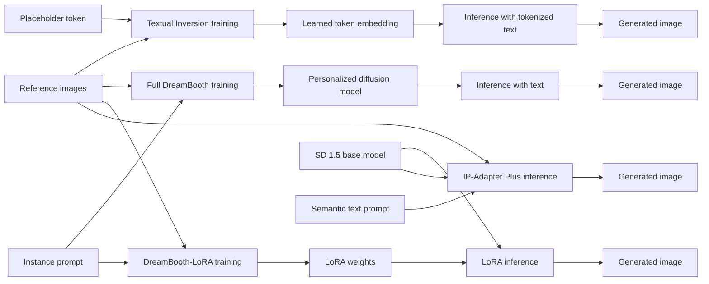

# Benchmarking Subject-Driven Personalization: Fine-Tuning vs. Tuning-Free

Reproducible Stable Diffusion 1.5 benchmark comparing Textual Inversion, full DreamBooth, DreamBooth-LoRA, and IP-Adapter Plus. DreamO is intentionally deferred as a separate, non-controlled modern-architecture extension.

The pilot subject is the non-human `dog2` subject from the official Google DreamBooth dataset. Identifiable humans and private photographs are excluded. Dataset provenance and the non-legal license summary are in `results/dataset_documentation.md`.

## Method inputs and outputs



- Textual Inversion trains reference images plus a placeholder token and outputs a learned embedding. Inference uses text containing that token.
- Full DreamBooth trains reference images plus an instance prompt and outputs a complete personalized diffusion model.
- DreamBooth-LoRA uses the same subject inputs but outputs compact LoRA weights applied to the base model at inference.
- IP-Adapter Plus performs no subject-specific training. It conditions inference on one reference image plus ordinary semantic text.

## Reproduce the completed pilot stages

```bash
bash scripts/setup_env.sh
conda activate personalization-benchmark
bash scripts/inspect_gpu.sh
bash scripts/download_models.sh
bash scripts/download_datasets.sh
python src/visualization/dataset_contact_sheet.py \
  --subject-dir data/processed/dreambooth/dog2 \
  --output-dir results/figures/dataset

source scripts/mig_devices.sh
CUDA_VISIBLE_DEVICES="$MIG3" bash scripts/generate_all.sh
CUDA_VISIBLE_DEVICES="$MIG3" bash scripts/evaluate_all.sh
```

Generation refuses to overwrite existing images. Move or assign a new experiment directory before rerunning a completed experiment.

## Prepared training jobs (not launched)

Each job uses one independent MIG instance. Do not use distributed training across MIG instances.

Prepare the shared deterministic prior-preservation set once before starting DreamBooth and LoRA. This avoids concurrent jobs racing while writing the same class-image directory:

```bash
source scripts/mig_devices.sh
CUDA_VISIBLE_DEVICES="$MIG3" bash scripts/jobs/prepare_class_images.sh
```

```bash
source scripts/mig_devices.sh
RUN_ID="dog2_db_s800_seed42" CUDA_VISIBLE_DEVICES="$MIG0" nohup bash scripts/jobs/train_dreambooth_pilot.sh > logs/train_dreambooth_pilot.nohup.log 2>&1 &
RUN_ID="dog2_lora_r16_s800_seed42" CUDA_VISIBLE_DEVICES="$MIG1" nohup bash scripts/jobs/train_lora_pilot.sh > logs/train_lora_pilot.nohup.log 2>&1 &
RUN_ID="dog2_ti_s3000_seed42" CUDA_VISIBLE_DEVICES="$MIG2" nohup bash scripts/jobs/train_ti_pilot.sh > logs/train_ti_pilot.nohup.log 2>&1 &
```

Monitor with `tail -f logs/<job>.log`, `watch -n 2 nvidia-smi`, and `ps -ef | grep '[p]ython'`.
For an experiment-aware summary, run `bash scripts/check_training_status.sh`.

Rough planning estimates on one 1g.35gb H200 MIG slice (26 SM, 33,280 MiB), to be replaced by measurements:

| Job | Expected VRAM | Expected wall time |
|---|---:|---:|
| Textual Inversion, 3,000 steps | 8–12 GB | 20–45 min |
| Full DreamBooth, 800 steps, prior preservation | 12–20 GB | 15–35 min plus initial class-image generation |
| DreamBooth-LoRA r16, 800 steps, prior preservation | 10–16 GB | 10–30 min plus initial class-image generation |

These are capacity estimates, not measured results. Concurrent first runs share the same class-image directory; generate that directory once or start DreamBooth after it exists to avoid races.

## Evaluation

- Subject fidelity: DINOv2 (`facebook/dinov2-base`) cosine similarity, reported as mean and maximum over every reference image.
- Prompt compliance: CLIP (`openai/clip-vit-large-patch14`) cosine similarity against the exact generation prompt.
- Overfitting: manual 0–2 annotations for background leakage, pose copying, and composition copying. Feature similarity is supporting evidence only.
- Compute: training time, peak VRAM, checkpoint size, trainable parameters, inference latency, and reference count are reported independently.

Do not interpret the current pilot metrics as a comparison: only IP-Adapter Plus has run. Cross-dataset results will be called “cross-dataset personalization performance,” not zero-shot transfer.

## Upstream implementations

Training invokes the official Hugging Face Diffusers v0.35.1 examples pinned under `third_party/diffusers`. The base model is `stable-diffusion-v1-5/stable-diffusion-v1-5`; adapter weights are SD1.5 `ip-adapter-plus_sd15.bin` from `h94/IP-Adapter`. Exact upstream revisions are recorded in `results/system/`.

